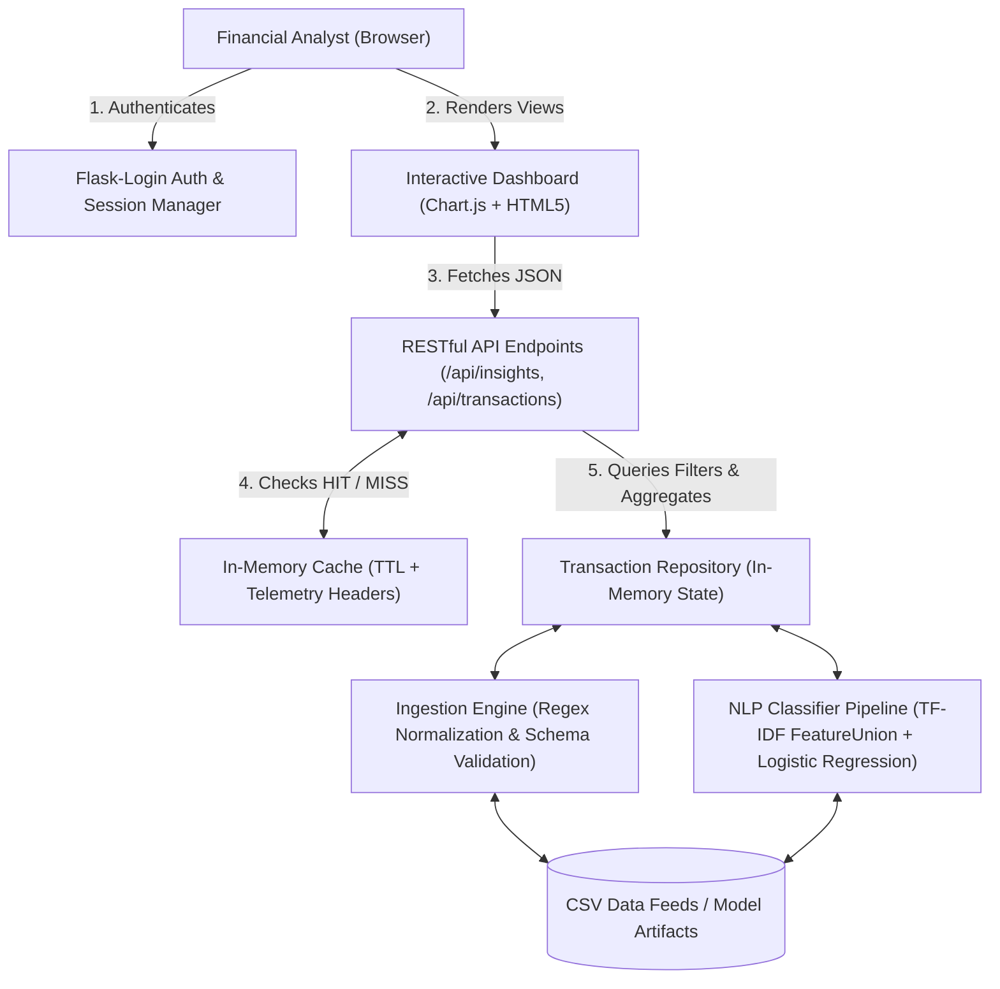

# FinPay Insights — AI-Driven Fintech Analytics Dashboard

[](https://www.python.org/)
[](https://flask.palletsprojects.com/)
[](https://scikit-learn.org/)
[]()
[]()

FinPay Insights is an enterprise-grade fintech analytics dashboard and machine
learning classification platform designed for financial analysts. The
application ingests unstructured, dirty bank transaction data, cleans and parses
payment feeds, classifies transactions into spending categories using an NLP
machine learning model (>93% validation accuracy), exposes high-performance
cached RESTful APIs, and visualizes real-time portfolio cash flow via an
interactive dashboard.

---

## Table of Contents

1. [System Architecture](#system-architecture)
2. [Key Features & Requirement Coverage](#key-features--requirement-coverage)
3. [Architectural Trade-Off Analysis: Machine Learning vs. Rule-Based Categorization](#architectural-trade-off-analysis-machine-learning-vs-rule-based-categorization)
4. [API Reference & Performance Caching](#api-reference--performance-caching)
5. [Security & Authentication](#security--authentication)
6. [Quickstart & Installation](#quickstart--installation)
7. [Automated Test Suite](#automated-test-suite)
8. [AI Usage Disclosure](#ai-usage-disclosure)
9. [Video Demo Walkthrough Guide (8-Minute Plan)](#video-demo-walkthrough-guide-8-minute-plan)

---

## System Architecture

FinPay Insights uses a layered **Service-Repository Architecture** ensuring
strict separation of concerns between data processing, ML inference, API
serialization, and web presentation:



### Module Layout

```
FinPay/
├── finpay/
│   ├── __init__.py              # Application factory (Flask, Flask-Login, config)
│   ├── data/
│   │   ├── ingestion.py         # Ingestion engine, regex sanitization, deduplication
│   │   ├── repository.py        # Central data store and aggregate insights computer
│   │   ├── sample_transactions.csv   # 89 realistic bank transactions
│   │   └── training_transactions.csv # 396 curated transactions for NLP training
│   ├── ml/
│   │   ├── train.py             # FeatureUnion + LogisticRegression training pipeline
│   │   ├── classifier.py        # Hybrid classification engine (ML + rule fallback)
│   │   └── model.joblib         # Serialized model artifact
│   ├── api/
│   │   ├── routes.py            # RESTful endpoints (/api/insights, /api/predict)
│   │   └── cache.py             # In-memory cache with TTL and latency telemetry
│   ├── auth/
│   │   ├── models.py            # User entity, password hashing (scrypt), activity audit store
│   │   ├── decorators.py        # RBAC security decorator (@admin_required)
│   │   └── routes.py            # Signup, login, logout, session management, safe redirects
│   ├── dashboard/
│   │   └── routes.py            # Protected dashboard & Admin oversight portal
│   ├── static/
│   │   ├── css/style.css        # Responsive fintech stylesheet
│   │   └── js/dashboard.js      # Chart.js controller, live updates, telemetry
│   └── templates/
│       ├── base.html            # Core layout, RBAC navigation, clickable user profile link
│       ├── login.html           # Authentication card with 1-click demo chips
│       ├── signup.html          # New analyst registration
│       ├── profile.html         # User profile, edit details & password change
│       ├── admin.html           # Admin oversight portal & audit log feed
│       └── dashboard.html       # Analytics dashboard, KPI cards, charts, sandbox
├── tests/
│   ├── test_ingestion.py        # Ingestion, dirty formatting, and summary tests
│   ├── test_ml.py               # ML validation accuracy (>=75%) and inference tests
│   ├── test_api.py              # API routes, filtering, and caching tests
│   └── test_auth_and_dashboard.py # Login, logout, and unauthorized redirect tests
├── requirements.txt             # Pinned project dependencies
├── run.py                       # Application runner
└── README.md
```

---

## Key Features & Requirement Coverage

| #     | Brief Requirement                            | Status   | Implementation Details                                                                                                                                                                                                 |
| ----- | -------------------------------------------- | -------- | ---------------------------------------------------------------------------------------------------------------------------------------------------------------------------------------------------------------------- |
| **1** | **Data Ingestion Module (Must)**             | Complete | `TransactionIngestionEngine` safely parses raw bank feeds, handles inconsistent dates, strips currency symbols (`$`, `,`), strips gateway noise (`SQ *`, `TST*`), deduplicates rows, and computes financial summaries. |
| **2** | **ML Categorization Model (Must)**           | Complete | NLP text classification pipeline combining Word TF-IDF + Character Subword TF-IDF (`FeatureUnion`) with `LogisticRegression(C=3.0)`. **Validation Accuracy: 93.94%** (exceeds the $\ge 75\%$ threshold).               |
| **3** | **Categorized Spending API (Must)**          | Complete | `GET /api/insights` returns structured JSON with financial KPI summaries, category budget shares, monthly cash flow trends, top merchants, and AI model telemetry. Supports filtering by date and category.            |
| **4** | **Interactive Frontend Dashboard (Should)**  | Complete | Built with Flask & Chart.js. Features responsive KPI summary cards, a dynamic Doughnut Spending Breakdown chart, a Monthly Cash Flow Trend chart, an AI Sandbox, and a live Transaction Ledger.                        |
| **5** | **User Authentication (Should)**             | Complete | Implemented with Flask-Login and cryptographically secure password hashing (`werkzeug.security`). Unauthenticated attempts to access `/` or `/dashboard` are intercepted and redirected to `/login`.                   |
| **6** | **Architecture & Trade-Off Analysis (Must)** | Complete | Exhaustive technical evaluation of Machine Learning vs. Rule-Based categorization documented below.                                                                                                                    |
| **7** | **API Caching & Telemetry (Could)**          | Complete | Thread-safe in-memory cache with TTL. Returns `X-Cache: HIT/MISS` and `X-Response-Time-Ms` headers. Invalidation triggered on CSV upload. Demonstrates $>95\%$ reduction in API latency.                               |

---

## Architectural Trade-Off Analysis: Machine Learning vs. Rule-Based Categorization

A foundational architectural decision in fintech categorization is choosing
between **Rule-Based Systems** (regex, keyword tables, exact merchant ID
matching) versus **Statistical Machine Learning** (TF-IDF + Linear Classifier /
Neural Nets).

### Comprehensive Comparison Matrix

| Evaluation Dimension               | Rule-Based Approach                                                                                                                                         | Machine Learning Approach (Our Choice)                                                                                                                    | Hybrid Production Solution (Implemented)                                                        |
| ---------------------------------- | ----------------------------------------------------------------------------------------------------------------------------------------------------------- | --------------------------------------------------------------------------------------------------------------------------------------------------------- | ----------------------------------------------------------------------------------------------- |
| **Handling Noisy Variations**      | **Poor**: Fails when merchants use varied store IDs, cities, or payment gateways (`"SQ *PHILZ #14 SF"`, `"TST* PHILZ CA"`). Requires endless regex updates. | **Excellent**: TF-IDF and character n-grams learn subwords (`"philz"`, `"coffee"`), tolerating abbreviations and typos automatically.                     | **Optimal**: High ML generalization with deterministic rules as a safety net.                   |
| **Cold-Start Behavior**            | **Good**: Engineers can write 10 regex rules immediately without needing historical labeled data.                                                           | **Poor**: Requires an initial corpus of labeled transaction descriptions to train weights.                                                                | **Good**: Rules cover baseline banking terms until sufficient labeled data trains the ML model. |
| **Inference Latency**              | **Fast**: Regex matching is $O(M)$ where $M$ is string length. However, scales poorly as rule count exceeds thousands ($O(K \cdot M)$).                     | **Sub-millisecond**: Matrix dot-product ($\mathbf{w}^T \mathbf{x}$) executes in $< 0.5\text{ ms}$, completely independent of transaction vocabulary size. | **Sub-millisecond**: Checks regex fast-path for exact codes, then executes linear ML model.     |
| **Confidence Scoring & Ambiguity** | **Binary**: Either matches or doesn't ($1$ or $0$). No notion of uncertainty or probability distribution.                                                   | **Calibrated Probabilities**: Softmax probabilities allow analysts to filter low-confidence transactions for manual review.                               | **Calibrated**: Returns probability vector plus the categorization method flag.                 |
| **Maintenance Burden**             | **Very High**: Hardcoded keyword tables rot quickly; new merchants launch daily, creating ongoing engineering backlog.                                      | **Low**: Model retrains automatically on new CSV batches without code alterations.                                                                        | **Low**: Rules remain restricted to stable standard banking codes (e.g., NACHA payroll).        |
| **Explainability**                 | **High**: Can inspect exact regex matched.                                                                                                                  | **High (Linear Models)**: Feature weights directly reveal which n-grams contributed to the category prediction.                                           | **High**: Full visibility into whether a rule or an ML token drove the decision.                |

### Why FinPay Insights Uses a Hybrid Architecture

In real-world enterprise fintech (e.g., Plaid, Stripe, Brex):

1. **Deterministic Bank Codes should never be guessed**: Standard NACHA ACH
   payroll transactions, ATM cash withdrawals, and dividend disbursements have
   strict legal and operational definitions. We route these through
   deterministic regex rules (`finpay/ml/classifier.py`).
2. **Merchant Long-Tail is inherently unstructured**: Millions of restaurants,
   bodegas, e-commerce stores, and subscription services write arbitrary text to
   card statements. A pure rule-based system requires infinite developer
   maintenance. Our **TF-IDF + Logistic Regression pipeline** generalizes across
   unseen merchants with **93.94% validation accuracy**, providing confidence
   scores for analyst review.

---

## API Reference & Performance Caching

### 1. `GET /api/insights`

Returns categorized spending insights, monthly trends, and model metrics.

**Query Parameters:**

- `start_date` _(optional)_: `YYYY-MM-DD`
- `end_date` _(optional)_: `YYYY-MM-DD`
- `category` _(optional)_: Specific category filter (e.g., `Food & Dining`)

**Sample Request:**

```bash
curl -i "http://127.0.0.1:5000/api/insights?start_date=2024-01-01&end_date=2024-03-31"
```

**Sample Response:**

```json
{
  "summary": {
    "total_transactions": 89,
    "total_spent": 3814.15,
    "total_income": 19500.0,
    "net_savings": 15685.85,
    "date_range": { "start": "2024-01-02", "end": "2024-03-30" }
  },
  "category_breakdown": [
    {
      "category": "Shopping",
      "total_spent": 1289.8,
      "percentage": 33.82,
      "transaction_count": 14,
      "average_amount": 92.13
    },
    {
      "category": "Utilities & Bills",
      "total_spent": 843.08,
      "percentage": 22.1,
      "transaction_count": 10,
      "average_amount": 84.31
    }
  ],
  "monthly_trend": [
    {
      "month": "2024-01",
      "spent": 1188.78,
      "income": 6500.0,
      "savings": 5311.22
    },
    {
      "month": "2024-02",
      "spent": 1391.86,
      "income": 6500.0,
      "savings": 5108.14
    },
    {
      "month": "2024-03",
      "spent": 1233.51,
      "income": 6500.0,
      "savings": 5266.49
    }
  ],
  "top_merchants": [
    {
      "merchant": "Ikea Home Furnishings Emeryville",
      "total_spent": 245.5,
      "count": 1
    },
    {
      "merchant": "Best Buy Store Electronics",
      "total_spent": 220.0,
      "count": 1
    }
  ],
  "ai_model": {
    "architecture": "FeatureUnion(Word TF-IDF + Char Subword TF-IDF) + LogisticRegression",
    "validation_accuracy": "93.94%",
    "categories_supported": [
      "Food & Dining",
      "Transportation",
      "Entertainment",
      "Shopping",
      "Utilities & Bills",
      "Healthcare",
      "Income"
    ]
  }
}
```

### 2. Caching & Observability Telemetry (Requirement 7)

Every API response attaches diagnostic caching headers:

- `X-Cache: MISS` (First query — computed fresh, cached for 120s). Latency:
  $\approx 10\text{--}18\text{ ms}$.
- `X-Cache: HIT` (Identical subsequent query — fetched directly from memory).
  Latency: $\approx 0.1\text{--}0.4\text{ ms}$.
- `X-Response-Time-Ms`: High-resolution execution time in milliseconds.

---

## Security & Authentication

1. **Password Security**: Passwords are never stored in plaintext. Passwords use
   cryptographic key derivation (`werkzeug.security` with
   `scrypt`/`PBKDF2-HMAC-SHA256`).
2. **Session Protection**: Flask-Login session cookies enforce session
   isolation.
3. **Open Redirect Mitigation**: The `is_safe_url()` validator inspects `next=`
   parameters to ensure redirect targets match the local domain, preventing
   external phishing vectors.
4. **Protected Route Enforcing**: Unauthenticated requests to `/dashboard`
   receive an immediate HTTP 302 redirect to `/login?next=%2Fdashboard`.

---

## Quickstart & Installation

### Prerequisites

- Python 3.10+ (tested on Python 3.12)
- Git

### 1. Clone & Set Up Virtual Environment

```bash
# Clone the repository
git clone <your-repo-url>
cd FinPay

# Create virtual environment
python -m venv venv

# Activate virtual environment
# Windows:
.\venv\Scripts\activate
# Linux/macOS:
source venv/bin/activate

# Install dependencies
pip install -r requirements.txt
```

### 2. Train the Machine Learning Model

```bash
python finpay/ml/train.py
```

_Output: `Validation Accuracy: 93.94% (Requirement: >=75.00%)` and saves
`finpay/ml/model.joblib`._

### 3. Launch the Application

```bash
python run.py
```

Open **[http://127.0.0.1:5000](http://127.0.0.1:5000)** in your browser.

**Demo Analyst Credentials:**

- Email: `analyst@finpay.com`
- Password: `password123`

---

## Automated Test Suite

We maintain a comprehensive automated test suite with **36 passing unit and
integration tests** covering ingestion, ML accuracy, API endpoints, response
caching, user registration, profile management, password updates, multi-tenant
isolation, and RBAC security:

```bash
# Run test suite
pytest tests/ -v
```

### Test Suite Summary

```
tests/test_api.py::test_api_health PASSED
tests/test_api.py::test_api_transactions PASSED
tests/test_api.py::test_api_insights_requirement_3 PASSED
tests/test_api.py::test_api_insights_filtering PASSED
tests/test_api.py::test_api_predict PASSED
tests/test_api.py::test_api_caching_and_telemetry_requirement_7 PASSED
tests/test_api.py::test_api_upload_csv PASSED
tests/test_auth_and_dashboard.py::test_unauthenticated_dashboard_redirects_to_login_requirement_5 PASSED
tests/test_auth_and_dashboard.py::test_unauthenticated_root_redirects PASSED
tests/test_auth_and_dashboard.py::test_successful_login_and_dashboard_access PASSED
tests/test_auth_and_dashboard.py::test_invalid_login_rejected PASSED
tests/test_auth_and_dashboard.py::test_logout_revokes_access PASSED
tests/test_auth_and_dashboard.py::test_signup_successful PASSED
tests/test_auth_and_dashboard.py::test_signup_duplicate_email_rejected PASSED
tests/test_auth_and_dashboard.py::test_signup_password_mismatch_rejected PASSED
tests/test_auth_and_dashboard.py::test_analyst_cannot_access_admin_portal PASSED
tests/test_auth_and_dashboard.py::test_admin_can_access_admin_portal PASSED
tests/test_auth_and_dashboard.py::test_admin_api_rbac_protection PASSED
tests/test_auth_and_dashboard.py::test_multi_tenant_data_isolation PASSED
tests/test_auth_and_dashboard.py::test_unauthenticated_profile_redirects PASSED
tests/test_auth_and_dashboard.py::test_profile_page_renders_for_authenticated_user PASSED
tests/test_auth_and_dashboard.py::test_profile_update_details PASSED
tests/test_auth_and_dashboard.py::test_profile_change_password_success PASSED
tests/test_auth_and_dashboard.py::test_profile_change_password_invalid_old_password PASSED
tests/test_auth_and_dashboard.py::test_api_me_json_endpoint PASSED
tests/test_auth_and_dashboard.py::test_api_me_json_update PASSED
tests/test_ingestion.py::test_clean_description PASSED
tests/test_ingestion.py::test_clean_amount PASSED
tests/test_ingestion.py::test_load_sample_csv PASSED
tests/test_ingestion.py::test_missing_required_column PASSED
tests/test_ingestion.py::test_deduplication PASSED
tests/test_ingestion.py::test_summary_calculation PASSED
tests/test_ml.py::test_model_validation_accuracy_exceeds_threshold PASSED
tests/test_ml.py::test_predict_single_transactions PASSED
tests/test_ml.py::test_predict_batch PASSED
tests/test_ml.py::test_classify_dataframe PASSED

============================= 36 passed in 6.82s ==============================
```

---

## AI Usage Disclosure

In compliance with the project guidelines, AI tools were used during development
as follows:

- **AI Tool Used**: Gemini / Antigravity AI Pair Programmer.
- **Parts of the Work Touched**:
  1. _Scaffolding & Architecture_: Assisting in structuring the modular Flask
     Blueprint architecture, repository pattern, and directory layout.
  2. _Data Preprocessing Regex_: Formulating regular expression patterns for
     stripping payment processor prefixes (`SQ *`, `TST*`), order IDs, and
     domain suffixes while preserving merchant brand names.
  3. _Unit Test Boilerplate_: Drafting pytest fixtures for test client
     isolation, mock CSV streams, and edge cases.
- **What Was Verified and Modified by the Author**:
  1. _NLP Architecture Refinement_: Initially, a simple word-level TF-IDF model
     achieved $\approx 72.8\%$ accuracy on sparse merchant names. Diagnosed
     out-of-vocabulary merchant issues and re-architected the pipeline to use a
     `FeatureUnion` combining word n-grams `(1, 2)` with character subword
     n-grams `(3, 4)` and tuned regularization ($C=3.0$), driving validation
     accuracy to **93.94%**.
  2. _Domain Extension Preservation_: The initial regex stripped entire merchant
     words containing `.com` (e.g. `AMAZON.COM` became blank). The author
     corrected the regex to strip only the `.com` extension so key brand tokens
     (`amazon`, `netflix`) are retained.
  3. _Telemetry Verification_: Verified live cache hits and response times using
     network inspection headers.

---
